# 🛡️ Awesome AI Agent Professional Liability Insurance Tools

<p align="center">
  
</p>

<p align="center">
  <a href="https://github.com/ishandutta2007/Awesome-Awesome-Awesome"></a>
  <a href="https://discord.gg/jc4xtF58Ve"></a>
  <a href="https://github.com/ishandutta2007/Awesome-AI-Agent-Professional-Liability-Insurance-Tools/stargazers"></a>
  <a href="https://github.com/ishandutta2007/Awesome-AI-Agent-Professional-Liability-Insurance-Tools/network/members"></a>
  <a href="https://github.com/ishandutta2007/Awesome-AI-Agent-Professional-Liability-Insurance-Tools/blob/main/LICENSE"></a>
  <a href="https://github.com/ishandutta2007/Awesome-AI-Agent-Professional-Liability-Insurance-Tools/pulls"></a>
  <a href="https://github.com/ishandutta2007"></a>
</p>

---

## 📌 Executive Summary & Scope

An SEO-indexed, curated repository tracking commercial **SaaS Insurtech Platforms**, specialized **AI Underwriters**, **Actuarial Risk Frameworks**, and **Open-Source Agent Governance & Guardrail Tools**.

As autonomous AI agents transition from passive natural language assistants into active production operators—executing database mutations, invoking third-party APIs, initiating wire transfers, and reconfiguring enterprise cloud infrastructure—they expose enterprises to unprecedented **operational, financial, and legal liabilities**. Traditional commercial liability policies and Tech Errors & Omissions (E&O) forms often contain ambiguous "silent AI" coverage or strict absolute AI exclusion endorsements.

This directory equips **insurance actuaries, cyber underwriters, risk engineers, Chief Risk Officers (CROs), and enterprise AI developers** with the tools, platforms, and empirical datasets required to quantify agent risk, structure enforceable warranties, and secure comprehensive professional liability coverage.

---

## 📑 Table of Contents

- [🌐 Sector Overview & Market Dynamics](#-sector-overview--market-dynamics)
- [💼 Commercial SaaS & Hosted Insurtech Platforms](#-commercial-saas--hosted-insurtech-platforms)
- [💻 Open-Source GitHub Projects](#-open-source-github-projects)
- [🔍 Core Failure Modes & Actuarial Underwriting Dimensions](#-core-failure-modes--actuarial-underwriting-dimensions)
- [⚖️ Legal Precedents & Regulatory Standards](#️-legal-precedents--regulatory-standards)
- [❓ Frequently Asked Questions (FAQ)](#-frequently-asked-questions-faq)
- [🤝 How to Contribute](#-how-to-contribute)
- [⚠️ Disclaimer](#️-disclaimer)
- [##  Star History](#--star-history)
- [☕ Support & Community](#-support--community)

---

## 🌐 Sector Overview & Market Dynamics

> **Market Size & Trajectory:** The global AI insurance and agent professional liability market is estimated to reach **$34.2 Billion by 2034**, expanding at a rapid compound annual growth rate (**CAGR of 24.6%**), as commercial cyber and Tech E&O gross written premiums surge past $25B globally.
>
> **Market Fragmentation & Structural Dynamics:** The market exhibits **moderate fragmentation with strong bifurcated concentration**. While upstream underwriting capacity and balance-sheet solvency are heavily concentrated among a few Tier-1 reinsurance giants and Lloyd's syndicates (*Chubb, Marsh, Munich Re, Beazley, Travelers*), the downstream distribution, telemetry ingestion, and verification layer is highly fragmented. A rapidly growing cohort of venture-backed Managing General Agents (MGAs) and insurtech startups (*Coalition, At-Bay, Resilience, Mount, Armilla AI*) compete dynamically on proprietary algorithmic risk scoring, real-time telemetry ingestion, and continuous agent auditing. The industry is currently transitioning from fragmented niche point solutions toward integrated InsurSec platforms.

---

## 💼 Commercial SaaS & Hosted Insurtech Platforms

The following table provides detailed commercial intelligence on category-leading SaaS products and cyber insurtech carriers offering AI liability endorsements, performance guarantees, and autonomous risk assessments.

*Note: Companies are sorted in descending order by scale (valuation / market capitalization / annual revenue).*

| Provider / Platform | Valuation / Company Scale | Specific Starting Pricing | Free Tier / Free Trial Limits | Target Risks & Policy Capabilities |
| :--- | :--- | :--- | :--- | :--- |
| **[Chubb](https://www.chubb.com/)** | **$115.0B Market Cap**<br>*(~$50.2B annual gross premiums)* | **$125 / month** ($1,500 / year)<br>*(Baseline small-commercial cyber & Tech E&O liability tier)* | **Free Cyber Incident Readiness Assessment**<br>*(1 company security posture assessment & loss control consultation, 0-day binding obligation)* | 🌐 Global Tier-1 commercial carrier; Cyber Enterprise Risk Management (ERM), autonomous agent performance endorsements, and international casualty capacity. |
| **[Marsh (Marsh McLennan)](https://www.marsh.com/)** | **$110.0B Market Cap**<br>*($23.0B annual revenue)* | **$416 / month** ($5,000 / year)<br>*(Baseline enterprise AI risk advisory & policy placement retainer)* | **Free AI Risk Index Self-Assessment**<br>*(1 company algorithmic risk exposure scorecard & benchmark review, 0-day obligation)* | 🏛️ World's largest insurance broker and risk advisor; structures bespoke Lloyd's syndicate lines, captive insurance, and AI liability treaty wording. |
| **[Munich Re (aiSure)](https://www.munichre.com/)** | **$68.0B Market Cap**<br>*(€60.8B annual gross revenue)* | **$25,000 / year** (~$2,083/mo)<br>*(Baseline performance guarantee tier; 2%–5% rate on $500K–$1M indemnity line)* | **Free Model Risk Intake Assessment**<br>*(1 AI model architecture feasibility audit report, 0-day binding obligation)* | 🛡️ Standalone AI performance guarantee policies, model drift peril coverage, algorithmic validation, and up to $15M capacity via Mosaic Insurance / Lloyd's. |
| **[Beazley](https://www.beazley.com/)** | **$10.2B Market Cap**<br>*(£7.8B market cap; $5.8B+ gross premiums)* | **$250 / month** ($3,000 / year)<br>*(Baseline tech errors & omissions / cyber liability SMB tier)* | **Free Breach Preparedness Audit**<br>*(1 company security posture evaluation & incident response triage, 0-day obligation)* | 🤖 Third-party algorithmic bias liability coverage, autonomous agent operational interruption, and Full Spectrum integrated cybersecurity support. |
| **[Coalition](https://www.coalitioninc.com/)** | **$5.0B Valuation**<br>*($775M+ run-rate GWP)* | **$83 / month** ($1,000 / year)<br>*(Micro/SMB starting cyber & active AI endorsement policy)* | **Free Forever Coalition Control®**<br>*(1 domain external attack surface scan, continuous automated vulnerability alerts, no policy purchase required)* | ⚡ Active Cyber Insurance with AI endorsements for Tech E&O forms, first-party Deepfake Response endorsements, and continuous automated risk monitoring. |
| **[At-Bay](https://www.at-bay.com/)** | **$1.35B Valuation**<br>*($575M acquisition by Munich Re)* | **$75 / month** ($900 / year base cyber)<br>*(Stance MDR add-on: $16/user/mo for Endpoint, $25/user/mo for Endpoint & Email)* | **Free Forever Exposure Calculator**<br>*(Unlimited interactive cyber loss benchmark simulations & risk exposure reports, 0-day obligation)* | 🔍 Full-stack InsurSec carrier with AI-driven underwriting (7x lower ransomware claim frequency), proactive vulnerability patching, and agent verification target. |
| **[Resilience](https://www.resilience.com/)** | **$1.0B Valuation**<br>*($325M total venture funding)* | **$1,250 / month** ($15,000 / year)<br>*(Mid-market baseline cyber + Tech E&O policy bundled with CRQ software access)* | **Free Cyber Risk Assessment Demo**<br>*(1 organization attack surface assessment & dollar-loss exposure interactive simulation, 0-day obligation)* | 📊 Middle-market and enterprise cyber risk quantification (CRQ), continuous telemetry evaluation, and specialized AI endorsement underwriting up to $10B revenue enterprises. |
| **[Chaucer Group](https://www.chaucergroup.com/)** | **$950M Valuation**<br>*($3.0B+ gross written premiums; China Re)* | **$208 / month** ($2,500 / year)<br>*(Vanguard SMB / technology startup policy tier)* | **Free Vanguard AI Risk Evaluation**<br>*(1 pre-underwriting algorithmic risk assessment, 0-day binding obligation)* | 🏛️ Lloyd's Syndicate 1084 capacity up to $15M–$30M, Vanguard AI risk framework, and hallucination liability partnership with Armilla AI. |
| **[Cowbell Cyber](https://www.cowbell.insure/)** | **$500M Valuation**<br>*($209M total venture funding)* | **$83 / month** ($1,000 / year)<br>*(Prime 100 standalone small-business cyber policy)* | **Free Forever Cowbell Insights**<br>*(1 company domain external risk audit with proprietary Cowbell Factor benchmark score, 0-day obligation)* | 📈 Adaptive AI underwriting engine, continuous Cowbell Factors risk modeling, automated risk mitigation, and tailored cyber/tech endorsements. |
| **[Corvus Insurance (Travelers)](https://www.corvusinsurance.com/)** | **$435M Valuation**<br>*($41B+ Travelers parent annual revenue)* | **$104 / month** ($1,250 / year)<br>*(Smart Cyber & Tech E&O entry commercial policy)* | **Free Forever Corvus CrowBar Scan**<br>*(1 dynamic IT vulnerability & cyber threat score report, 0-day obligation)* | 🔎 Proprietary AI-powered vulnerability scanning, data-driven underwriting models exceeding $200M book of business, and automated broker digital workflow. |
| **[Apollo ibott Syndicate 1971](https://www.apollounderwriting.com/)** | **$315M Capacity**<br>*(£250M+ stamp capacity; $1B+ Apollo Group)* | **$1,666 / month** ($20,000 / year)<br>*(Commercial agentic & autonomous workflow fleet policy minimum account premium)* | **Free Digital Fleet Risk Review**<br>*(1 autonomous system workflow risk intake consultation & underwriting screen, 0-day obligation)* | 🚀 Lloyd's of London specialized syndicate for sharing economy, digital platforms, and autonomous/agentic systems executing high-frequency decisions. |
| **[Armilla AI](https://www.armilla.ai/)** | **$25M Est. Valuation**<br>*($6.0M venture funding raised)* | **$833 / month** ($10,000 / year)<br>*(Armilla Guaranteed startup model warranty tier for up to $500K indemnity limit)* | **Free 14-Day Evaluation Access**<br>*(14-day trial of Armilla Verified AI Governance & EU AI Act / NIST readiness checklist, 1 model audit report)* | 🧪 Specialized AI liability & warranty MGA backed by Lloyd's (Swiss Re, Chaucer, Greenlight Re), offering hallucination and model drift coverage up to $25M capacity. |
| **[Mount (Y Combinator)](https://www.mount.insure/)** | **$15M Valuation**<br>*($500K+ YC seed funding)* | **$500 / month** ($6,000 / year)<br>*(Seed/Series A agentic startup liability tier with $1M coverage limits)* | **Free 14-Day Red-Teaming Trial**<br>*(14-day automated agent security scan: 1 production agent workflow prompt-injection & tool abuse evaluation)* | 🤖 AI-native insurance carrier purpose-built for autonomous AI agents; scans & red-teams live workflows to insure residual operational liability and cascade failures. |

---

## 💻 Open-Source GitHub Projects

Explore the open-source software ecosystem providing the technical foundation for autonomous agent observability, deterministic policy gating, actuarial loss distributions, and runtime sandboxing.

*Note: Repositories are strictly sorted in descending order by GitHub stargazer count.*

1. **[LiteLLM (BerriAI)](https://github.com/BerriAI/litellm)** [](https://github.com/BerriAI/litellm/stargazers)  
   Enterprise AI gateway and proxy. Implements spend tracking, per-user budget caps, rate limiting, and fallback routing across 100+ LLMs. Crucial for underwriters to verify protection against runaway recursion loops and financial token explosion liability.

2. **[Langfuse](https://github.com/langfuse/langfuse)** [](https://github.com/langfuse/langfuse/stargazers)  
   Open-source LLM application tracing, agent evaluation, and observability platform. Records multi-step agent interactions, cost allocations, latency, and quality metrics—enabling forensic audit trails essential for post-claim insurance investigations.

3. **[DeepEval (Confident AI)](https://github.com/confident-ai/deepeval)** [](https://github.com/confident-ai/deepeval/stargazers)  
   Enterprise unit-testing and evaluation framework for LLMs and autonomous agents. Quantifies production hallucination rates, tool-call accuracy, toxicity, and adherence to safety policies. Generates empirical baseline error distributions essential for actuarial underwriting.

4. **[E2B (Agent Sandbox)](https://github.com/e2b-dev/E2B)** [](https://github.com/e2b-dev/E2B/stargazers)  
   Secure isolated execution runtime for autonomous AI agents and coding tools. Prevents unauthorized host manipulation, network breakout liability, and data exfiltration by executing untrusted agent code in dedicated firewalled microVM environments.

5. **[Arize Phoenix](https://github.com/Arize-ai/phoenix)** [](https://github.com/Arize-ai/phoenix/stargazers)  
   AI observability, OpenTelemetry agent execution tracing, evaluation, and drift detection. Records fine-grained step-by-step traces of multi-agent interactions, tool invocations, token spend, and execution latency for post-incident forensic liability audits.

6. **[Guardrails AI](https://github.com/guardrails-ai/guardrails)** [](https://github.com/guardrails-ai/guardrails/stargazers)  
   Runtime specification and validation framework for structured AI outputs and actions. Enforces strict JSON schemas, policy constraints, and content integrity to block defamatory outputs, regulatory breaches, or unauthorized tool executions before actions are finalized.

7. **[NeMo Guardrails (NVIDIA)](https://github.com/NVIDIA/NeMo-Guardrails)** [](https://github.com/NVIDIA/NeMo-Guardrails/stargazers)  
   Open-source toolkit for adding programmable guardrails to LLM-based conversational and agentic systems. Defines topical, safety, and security guardrails via Colang to enforce operational boundaries and eliminate unauthorized decision delegation.

8. **[Microsoft Agent Governance Toolkit](https://github.com/microsoft/agent-governance-toolkit)** [](https://github.com/microsoft/agent-governance-toolkit/stargazers)  
   Enterprise Site Reliability Engineering (SRE) and governance framework for AI agents. Defines SLOs for autonomous tasks, prevents infinite runaway tool loops (Cost Guard), arrests cascading failure propagation across agent meshes (Circuit Breaker), and maintains cryptographically verifiable Merkle audit logs.

9. **[Giskard](https://github.com/Giskard-AI/giskard)** [](https://github.com/Giskard-AI/giskard/stargazers)  
   Testing, auditing, and risk evaluation framework for AI models and LLM agents. Features automated red-teaming for prompt injection, data leakage, discrimination, and hallucinations, automatically generating compliance artifacts for the EU AI Act and NIST AI RMF.

10. **[Purple Llama (Meta)](https://github.com/meta-llama/PurpleLlama)** [](https://github.com/meta-llama/PurpleLlama/stargazers)  
    Umbrella project of trust and safety evaluation tools, including CyberSec Eval (benchmarking agent cybersecurity risk) and Llama Guard (input/output safety classification) to quantify model exploitability for cyber underwriting.

11. **[TruLens](https://github.com/truera/trulens)** [](https://github.com/truera/trulens/stargazers)  
    Evaluation and governance framework tracking the "RAG Triad" and agentic reasoning paths. Instruments autonomous agents to quantify groundedness, context relevance, and drift—enabling actuaries to benchmark algorithmic reliability over time.

12. **[LLM Guard (Protect AI)](https://github.com/protectai/llm-guard)** [](https://github.com/protectai/llm-guard/stargazers)  
    Production-grade security toolkit designed to sanitize inputs and outputs of LLMs and autonomous agents. Detects malicious prompt injections, PII disclosures, ban-list violations, and code execution vulnerabilities that could trigger statutory liability.

13. **[OpenTelemetry GenAI Semantic Conventions](https://github.com/open-telemetry/semantic-conventions)** [](https://github.com/open-telemetry/semantic-conventions/stargazers)  
    Vendor-neutral telemetry specifications for generative AI and autonomous agent systems. Normalizes span attributes across model invocations, tool parameters, token usage, and exceptions—providing standard telemetry for insurance claim adjudication.

14. **[VerifyWise](https://github.com/verifywise-ai/verifywise)** [](https://github.com/verifywise-ai/verifywise/stargazers)  
    Open-source AI governance, risk, and compliance (GRC) platform. Maintains centralized inventories of AI systems, evaluations, and suppliers while cross-mapping controls against EU AI Act, ISO/IEC 42001, and NIST AI RMF.

15. **[MITRE ATLAS Data](https://github.com/mitre-atlas/atlas-data)** [](https://github.com/mitre-atlas/atlas-data/stargazers)  
    Knowledge base of adversary tactics, techniques, and real-world case studies for Artificial Intelligence systems. Includes specialized sub-techniques for AI Agent Tool Poisoning, goal manipulation, and memory compromise used by underwriters for threat modeling.

16. **[FAIR Risk Analysis Dashboard](https://github.com/paolocarner/fair-monte-carlo-risk-analysis)** [](https://github.com/paolocarner/fair-monte-carlo-risk-analysis/stargazers)  
    Interactive Cyber Risk Quantification (CRQ) Monte Carlo simulation engine utilizing the Factor Analysis of Information Risk (FAIR) framework. Simulates 1,000–50,000 annual loss iterations (Loss Event Frequency × Loss Magnitude) to quantify insurance policy attachment points and optimal policy limits.

17. **[CRML — Cyber Risk Modeling Language](https://github.com/Faux16/crml)** [](https://github.com/Faux16/crml/stargazers)  
    Open, declarative domain-specific language for expressing cyber and autonomous systems risk models, simulation pipelines, and actuarial requirements. Quantifies defensive control effectiveness and loss distributions with strict JSON Schema verification.

18. **[Kova (Nobulex)](https://github.com/arian-gogani/nobulex)** [](https://github.com/arian-gogani/nobulex/stargazers)  
    Open actuarial risk infrastructure for AI agents providing three core primitives: Identity Binding (cryptographic accountability), Covenant Declaration (pre-authorized behavioral commitments), and Compliance Proof (tamper-evident audit receipts) that allow underwriters to price verifiability directly into premiums.

19. **[AgentTrust](https://github.com/chenglin1112/AgentTrust)** [](https://github.com/chenglin1112/AgentTrust/stargazers)  
    Deterministic verification schema and CI gate for autonomous agent actions. Enforces an explicit "prepare → seal → authorize → commit → verify" lifecycle with rule checks against unauthorized fund transfers, unintended deletions, or unreviewed deployments.

20. **[Vaara](https://github.com/vaaraio/vaara)** [](https://github.com/vaaraio/vaara/stargazers)  
    Open-source governance and evidence layer for autonomous agents. Intercepts each action against organizational risk policies, calculates real-time risk scores (allow / block / escalate), and creates tamper-evident hash-chained audit trails aligned with EU AI Act Article 12 requirements.

21. **[Agent Sandbox Runtime](https://github.com/ixchio/agent-sandbox-runtime)** [](https://github.com/ixchio/agent-sandbox-runtime/stargazers)  
    Docker-isolated execution runtime with Reflexion feedback loops and specialist sandboxing agents, providing safe environments to contain unintended agent code execution and mitigate liability.

22. **[Cyber Risk Platform](https://github.com/sabrinahaniff/cyber-risk-platform)** [](https://github.com/sabrinahaniff/cyber-risk-platform/stargazers)  
    Open-source AI-driven cyber insurance underwriting engine. Automates technical vulnerability assessments (0–100 scoring engine) across enterprise attack vectors and generates automated underwriting risk decision memos.

23. **[Autonomous License Compact](https://github.com/RealistSec/Autonomous-License-Compact)** [](https://github.com/RealistSec/Autonomous-License-Compact/stargazers)  
    Technical framework for insurable, verifiable autonomous agents. Implements the "Fleet & Driver" liability model and OCSP-style API revocation linked to an insured entity or owner.

24. **[CausalLayer MCP](https://github.com/smq9sn5jck-coder/causallayer-mcp)** [](https://github.com/smq9sn5jck-coder/causallayer-mcp/stargazers)  
    Deterministic AI liability attribution engine implemented as a Model Context Protocol (MCP) server. Generates cryptographically signed CausalCertificates for AI incident forensics and EU AI Act Article 12 compliance.

---

## 🔍 Core Failure Modes & Actuarial Underwriting Dimensions

When underwriters and actuaries price professional liability and Tech E&O policies for AI agents, they evaluate exposure across four distinct technical failure modes:

```
┌────────────────────────────────────────────────────────────────────────┐
│                   AI AGENT ACTUARIAL EXPOSURE TAXONOMY                 │
├────────────────────┬────────────────────┬──────────────────────────────┤
│ Operational Risk   │ Cascading Risk     │ Adversarial Risk             │
├────────────────────┼────────────────────┼──────────────────────────────┤
│ • Runaway Loop     │ • Inter-Agent      │ • Prompt Injection (Direct)  │
│   Token Explosion  │   Hallucination    │ • Indirect Tool Poisoning    │
│ • Tool Schema      │ • Multi-Agent Dead │ • Supply-Chain Dependency    │
│   Drift Breaches   │   Lock / Contagion │   Compromise (MCP / PyPI)    │
└────────────────────┴────────────────────┴──────────────────────────────┘
```

1. 💸 **Runaway Execution & Cost Overruns**: Unbounded tool recursion or recursive agent loops consuming tens of thousands of dollars in cloud infrastructure or third-party APIs within minutes. Mitigated via gateways like **LiteLLM** and **Agent SRE Cost Guard**.
2. 🔄 **Cascading Multi-Agent Hallucinations**: In autonomous agent meshes, Agent A accepts an unchecked hallucination from Agent B as ground truth, compounding the error downstream and executing irreversible corporate transactions.
3. 🛠️ **Tool Drift & MCP Schema Breaking**: Subtle schema migrations in Model Context Protocol (MCP) servers or third-party APIs that result in erroneous parameters passed to high-consequence endpoints (e.g., payment gateways, database deletions).
4. 🎭 **Data Exfiltration & Poisoning**: Prompt injection or tainted web retrieval inducing the agent to ignore system boundaries and exfiltrate confidential enterprise data.

---

## ⚖️ Legal Precedents & Regulatory Standards

- 📜 **EU AI Act (Article 12 & 26)**: Mandates automatic recording of events ("logging") over the entire lifetime of high-risk AI systems, requiring deployers to retain logs for at least 6 months. Tamper-evident systems like Vaara and CausalLayer MCP provide direct compliance artifacts.
- 🏛️ **NIST AI Risk Management Framework (AI 600-1 GenAI Profile)**: Emphasizes 12 core Generative AI risk profiles and continuous governance verification.
- ⚖️ **The Workday Precedent (*Mobley v. Workday*)**: Established that third-party AI platform vendors may carry direct statutory liability if consequential personnel or operational decisions are delegated to autonomous algorithmic systems.
- 📋 **ISO/IEC 42001:2023**: Specifies international requirements for establishing, implementing, maintaining, and continually improving an Artificial Intelligence Management System (AIMS).
- 🔒 **ISO Circular & Absolute AI Exclusions**: The Insurance Services Office (ISO) filed standardized commercial exclusions for generative AI, requiring explicit manuscript endorsements or affirmative standalone policies to cover agentic actions.

---

## ❓ Frequently Asked Questions (FAQ)

### What is AI Agent Professional Liability Insurance?
AI Agent Professional Liability Insurance (also referred to as Autonomous Agent Tech E&O) is a specialized commercial casualty product designed to indemnify enterprises and software developers against financial loss, regulatory fines, and third-party damages caused by autonomous AI agents executing unauthorized, erroneous, or biased actions in production.

### Why do standard Cyber Insurance or Tech E&O policies fail to cover AI agents?
Legacy policies frequently rely on "Silent AI" positions or explicitly invoke absolute AI exclusion endorsements. Traditional Tech E&O assumes human negligence in software engineering, whereas autonomous agents introduce stochastic decision-making, non-deterministic API invocations, and prompt-injection vulnerabilities that fall outside classic cyber underwriting definitions.

### How do underwriters quantify autonomous agent risk?
Underwriters utilize quantitative metrics including:
- **Baseline Hallucination Rate** across standard benchmarks (via tools like DeepEval, TruLens).
- **Execution Sandboxing** isolation grade (e.g., microVM containment via E2B).
- **Deterministic Action Gating** and budget limits (via LiteLLM, Guardrails AI, AgentTrust).
- **Cryptographic Auditability** and tamper-evident event logging (via Vaara, CausalLayer MCP).

---

## 🤝 How to Contribute

We welcome contributions from actuaries, cybersecurity researchers, and agent engineers!

1. 🍴 **Fork the repository** on GitHub.
2. 🌿 **Create a descriptive branch** (`git checkout -b feat/add-new-risk-tool`).
3. ✍️ **Add or edit entries in `README.md`**:
   - For SaaS tools: Include specific starting price, specific free tier/trial limits, valuation or revenue, and capability description.
   - For Open-Source tools: Include owner/repo name, Stars_Badge linking to `/stargazers`, and precise functional scope. Keep list sorted by stars descending.
4. 🚀 **Submit a Pull Request** with a concise description of the addition.

---

## ⚠️ Disclaimer

- This repository is a community-curated educational index and does not constitute formal legal, actuarial, or financial underwriting advice.
- **Silent AI default position:** Many legacy corporate policies neither grant nor formally exclude AI risk—meaning the policyholder frequently funds the test litigation. Consult with an accredited insurance broker to review explicit AI endorsement wordings.
- **Verification frameworks provide risk infrastructure, not balance-sheet capacity:** Open-source frameworks provide data structures for covenant compliance and breach attestation; licensed insurance carriers provide formal policy binding and risk transfer.

---

##  Star History

[](https://star-history.dera.page/#ishandutta2007/Awesome-AI-Agent-Professional-Liability-Insurance-Tools&type=date&legend=top-left)

---

## ☕ Support & Community

If this repository helps you navigate AI agent liability, insurance underwriting, or actuarial frameworks, please consider supporting the project:

- 🌟 **Star this repository** on GitHub to increase visibility.
- 🍴 **Fork and contribute** open-source tools or carrier updates.
- 📢 **Share with colleagues**, actuaries, risk officers, and agent builders.
- ☕ **Sponsor the maintainer** or buy a coffee via the [GitHub Sponsor Dashboard](https://github.com/sponsors/ishandutta2007).

Thank you for helping build a safer, verifiable, and economically accountable AI agent ecosystem!
